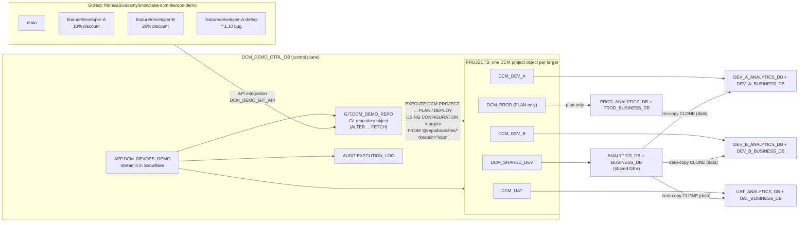
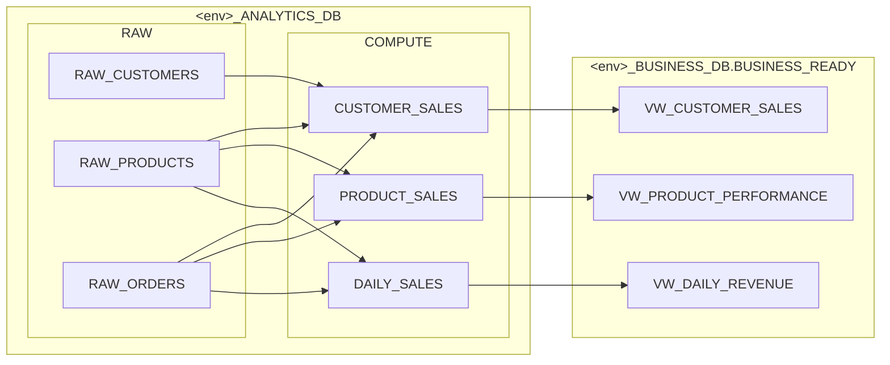

# Architecture

## Git → Snowflake → DCM → target environments

## Data flow inside every environment

## Responsibilities

| Layer | Responsibility | Tool |
|---|---|---|
| Source code | Versioned SQL definitions, branches, review, merge | Git / GitHub |
| Desired state | `DEFINE` statements + Jinja per target | DCM project files (`dcm/`) |
| Change computation | Render, compile, compute CREATE/ALTER/DROP | `EXECUTE DCM PROJECT ... PLAN` |
| Change application | Apply changeset, record deployment, own objects | `EXECUTE DCM PROJECT ... DEPLOY` |
| Generic data quality | Nulls, duplicates, volume, min | DCM expectations (`TEST ALL`) |
| Business correctness | Recompute from RAW, reconcile layers, business rules | `validation/business_rules.sql` |
| Isolation | Separate objects per developer | Separate databases + DCM project per target |
| Data for sandboxes | Instant, storage-free copies | Zero-copy `CLONE` |
